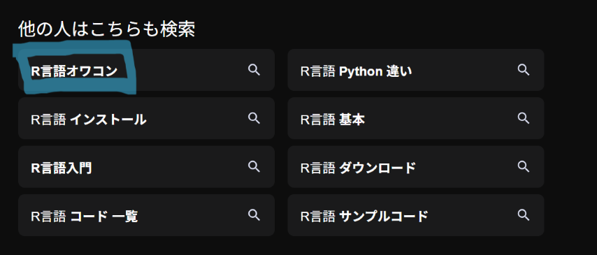
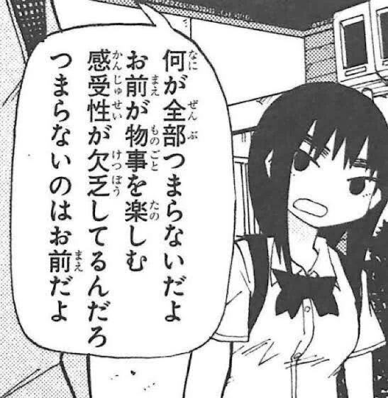
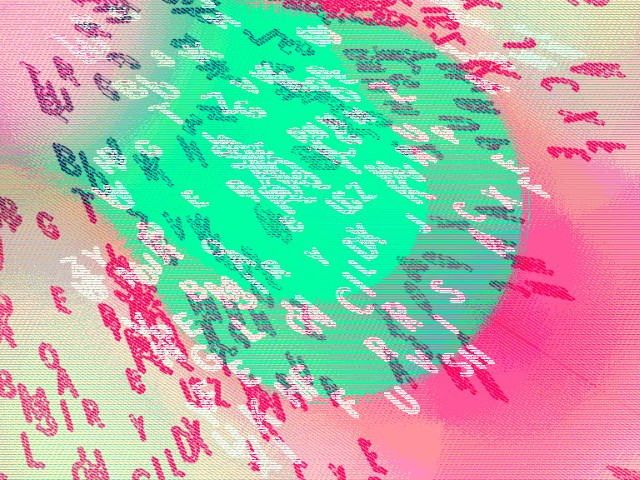
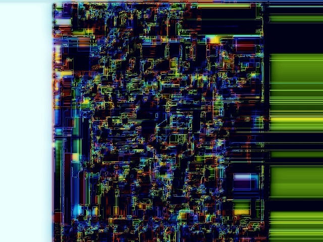
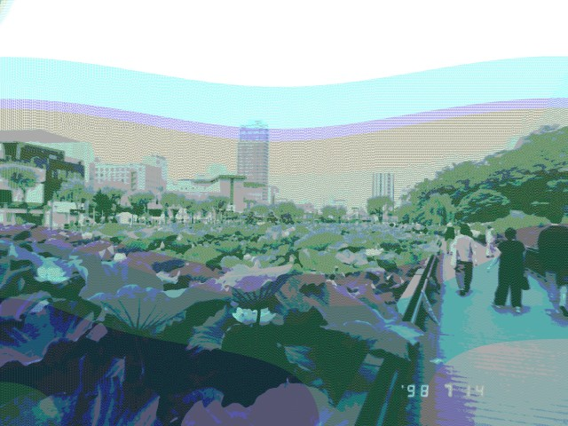
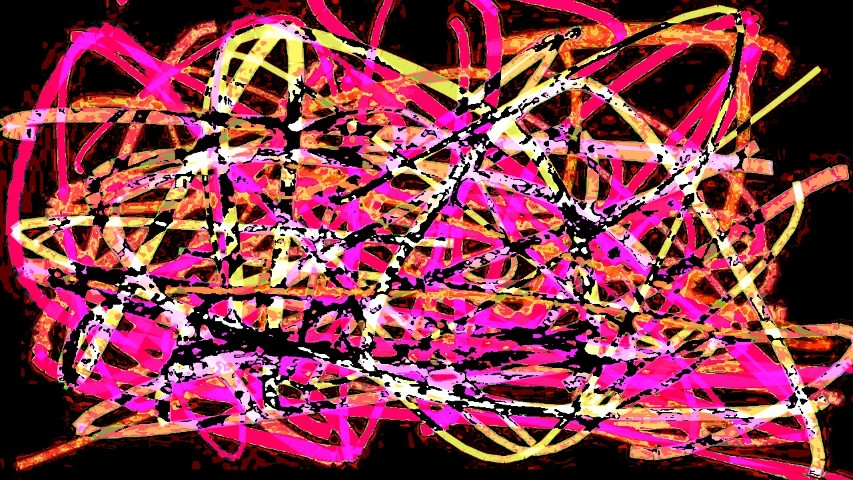
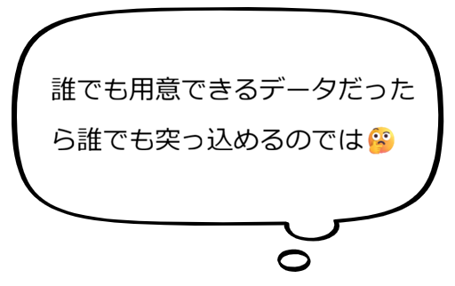

# 誰？

:::{.columns}
:::{.column width="30%"}
{.rounded-full}
:::

:::{.column width="70%"}
- あきる（[paithiov909](https://github.com/paithiov909)）というアカウントでインターネットしている
- 趣味でRパッケージをつくったりしている
  - [skiagd](https://github.com/paithiov909/skiagd)
  - [rasengan](https://github.com/paithiov909/rasengan)
  - [aznyan](https://github.com/paithiov909/aznyan) / [nativeshadr](https://github.com/paithiov909/nativeshadr)
  - [rravif](https://github.com/paithiov909/rravif)
:::
:::

# Tokyo.Rでありがちなこと

:::{.incremental}
- R言語の勉強会だから***統計やデータ分析についての高度な発表を準備しないとダメ***だと思ってない？
- たぶん、大事なのはそういうことじゃない
- ***自分なりのRの使い方***を共有することがポイント
:::

#

:::{.fukidashi-01-08}
[Q.「自分なりのR言語の使い方」を共有できるとどうしてRコミュニティ的にポイント高いのか🤔]{.center}
:::

#

:::{.fukidashi-01-08}
[A. 統計やデータ分析なんてAIにでもやらせておけばOKだからです🤬]{.center}
:::

# R言語はオワコンなのか

## Rを取り巻く最近のトピック

:::{.incremental}
- tidyverseのエコシステムの成熟
- 新しいツールやAIコーディングの普及（[Positron](https://positron.posit.co/), [arf](https://github.com/eitsupi/arf), [btw](https://posit-dev.github.io/btw/), etc.）
- Positの人たちが構想している[R in Production](https://r-in-production.org/introduction.html)という路線
:::

### ✅むしろ着実に進化している{.fragment .fade-up}

## なぜオワコンに見えるのか

:::{.incremental}
1. Rユーザーの興味は***自分の役に立つかどうか***に偏りがち
2. ***データ分析には役に立たなそうな話***はコミュニティ内で広くは紹介されない
3. 一般的な***コードを書く作業***はAIが代行してくれる
:::

:::{.r-stack}
{.fragment}

[➡もう終わってるコンテンツらしい…]{.fragment style="color: #f00; font-weight: bold; text-shadow: 1px 1px 1px #000;"}
:::

## オワコン化の流れに抵抗する

:::{.r-stack style="height: 80%;"}
{.fragment}

{.fragment}

[R言語がつまらないんじゃない<br />お前がおもしろくするんだよ！]{.fragment style="display: inline-block; text-align: center; font-size: 1.6em; color: hotpink; font-weight: bold; text-shadow: 4px 4px 4px #fff; background: #96e7e7c3; border-radius: 16px; padding: 16px; margin: 12px 0;"}
:::

[画像：阿部共実『死にたくなるしょうもない日々が死にたくなるくらいしょうもなくて死ぬほど死にたくない日々（１）』から]{style="color: #777; font-size: 0.4em;"}

## 使い方はハウツーのことじゃない

:::{style="color: #777;"}
- AIにコードを書かせるだけなら、あえてRを書きたい場面は減っていく
- それでも人間がコードを書かざるをえないような場面においては、人間のためのコーディング体験が問われる
- 人間にとっての体験の良し悪しはAIに訊いてもわからない
:::

### ❤️‍🔥Rでできることじゃなく体験の話をしろ!!{.fragment .fade-up}

# R言語によるアートづくり

## 作品例 (1/3)

[
  {.carousel-item}
  {.carousel-item}
  {.carousel-item}
  {.carousel-item}
]{.carousel}

[過去の自作から抜粋]{style="color: #777; font-size: 0.7em;"}

## 作品例 (2/3)



## 作品例 (3/3)



## なぜR言語なのか

:::{.incremental}
- クリエイティブコーディング向けのフレームワークやライブラリは他言語実装がたくさんある
- 他言語で便利にできることをそのままRでできるようにしてもべつに嬉しくない
- むしろ重要なのは***Rらしい書き方ができる***こと
:::

### 🎯「R言語でやってみた」よりも「Rらしい体験である」ことが重要{.fragment .fade-up}

#

:::{.fukidashi-01-08}
[Q. ***R言語によるクリエイティブコーディング***とはどのような体験であるべきか🧐]{.center}
:::

#

:::{.fukidashi-01-08}
[A. ***時間を引数にしたデータ変換と画像生成パイプライン***としてクリエイティブコーディングするという体験]{.center}
:::

# RコードのRらしさって何だろう？

- [ア（@yuruyurau）](https://x.com/yuruyurau)さんによる[つぶやきProcessing](https://x.com/yuruyurau/status/1226846058728177665)作品から移植したコードを題材に考えてみる
- 実際の移植にあたっては[coolbutuseless/narademos](https://github.com/coolbutuseless/narademos)も参考にした


## p5.jsコードとの比較

:::{.panel-tabset}

## p5.jsで移植した例

:::{.columns}

:::{.column width="60%"}
```{=html}
<div id="cv-bubble-universe"></div>
```
:::
:::{.column width="40%"}
:::{style="color: #777;"}
  左図は画像ではなく、実際にp5.jsのスケッチを埋め込んでいる

  "c"キーで一時停止・再生
:::
:::

:::

## p5.jsコード

```js
const W = 540;
const N = 60;  // 元の作品では200だが、ここではひかえめにしている
let x, y, t;
let running = false;

// セットアップ
function setup() {
  let cnv = createCanvas(W, W, WEBGL);
  cnv.parent("cv-bubble-universe");

  x = 0; y = 0; t = 0; // 変数の初期化

  noStroke();     // ストロークをなしに
  blendMode(ADD); // ブレンドモードを加算に
  frameRate(3);   // 軽くするためにフレームレートを適当に下げる
  background(0);
}

// ループのなかで呼ばれる関数
function f(i, j) {
  // 座標の計算
  let r = TAU / N;
  let u = sin(i+y) + sin(r*i+x);
  let v = cos(i+y) + cos(r*i+x);
  x = u+t; y = v;

  fill(i, j, (v+2)*N/4);   // 色
  circle(u*N/2, v*N/2, 2); // この位置に直径2の円を描く
}

// フレームごとに呼ばれる描画処理
function draw() {
  if (!running) return; // 停止中は更新しない
  background(0); // 背景色で塗りつぶす
  scale(2.5);    // 全体を2.5倍に拡大

  // ループ
  for (i = 0; i < N; i++) {
    for (j = 0; j < N; j++) {
      f(i, j);
    }
  }
  t += 0.1; // tを増やす
}

function keyPressed() {
  if (key == 'c') {
    running = !running;
  }
}
```

## skiagdコード

```r

```

:::

## skiagdで描画した例



## skiagdコードの特徴 (1/2)

- データ駆動・宣言的な描画処理
  - [一つ一つの図形を描く処理を繰り返すのではなく、何をどこに描くかを表現するデータをあらかじめ用意しておいて一度に描画する]{style="color: #777;"}
- 純粋関数とパイプを使った書き方
  - [描画処理は時間$t$を受け取って対応するフレームを返す純粋関数と見なせる]{style="color: #777;"}
  - [描画結果も副作用ではなく値として返されるので、それらをパイプでつなぎながら処理を書く]{style="color: #777;"}

## skiagdコードの特徴 (2/2)

- 対話的環境で素早く試行錯誤できる
  - [元データも描画結果も値として持っているため、制作途中で部分実行して中身を確認することができる]{style="color: #777;"}
  - [パイプラインの一部を変更して試しに実行してみるコストがとても低い]{style="color: #777;"}
- 「Rらしさ」ゆえに書きにくい表現もある
  - [データが可変長、参照関係や履歴を保持するような状態遷移を含む場合、tidyverse的な表現では力不足]{style="color: #777;"}
  - [命令的なインタラクションをもたない]{style="color: #777;"}

## 試行錯誤のようす (1/4)

```{r}
#| label: fig1-bubble-universe
#| output-location: column
#| echo: true
#| fig-width: 7.5
#| fig-height: 7.5
library(skiagd)

W <- 540L
N <- 280L
tau <- 2 * pi

# いきなり全フレームを生成する
# ループを組み立てるのではなく、
# 1フレームだけ生成して確認する作業を
# 繰り返しながらデザインを決めていく

# そのために`t`を適当に固定する
t <- 1.234

# 中身を確認しながら元データをつくる
x <- y <- 0
r <- tau / N
dat <-
  tidyr::expand_grid(i = seq(N), j = seq(N)) |>
  dplyr::group_by(i) |>
  dplyr::group_modify(~ {
    xs <- ys <- double(N)
    for (j in .x$j) {
      u <- sin(.y$i + y) + sin(r * .y$i + x)
      v <- cos(.y$i + y) + cos(r * .y$i + x)
      x <<- u + t
      y <<- v
      xs[j] <- u
      ys[j] <- y
    }
    data.frame(
      j = .x$j,
      x = xs,
      y = ys,
      z = 1,
      col = rgb(.y$i, .x$j, (y + 2) * N / 4, maxColorValue = N)
    )
  }) |>
  dplyr::ungroup()

dat

# 宇宙っぽく輝いている雰囲気にしたいので
# 後段でエフェクトをかけてみる
rast <-
  canvas("black") |>
  add_point(
    dat |>
      dplyr::select(x, y, z) |>
      as.matrix() %*%
      affiner::transform2d() %*%
      affiner::scale2d(N / 2) %*%
      affiner::translate2d(W / 2, W / 2),
    group = seq_len(nrow(dat)),
    color = dplyr::pull(dat, col) |>
      col2rgba(),
    props = paint(
      width = 2,
      blend_mode = BlendMode$Plus,
    )
  ) |>
  as_nativeraster() |>
  aznyan::diffusion_filter(factor = 3) |>
  aznyan::median_blur()

grid::grid.newpage()
grid::grid.raster(rast, interpolate = FALSE)
```

## 試行錯誤のようす (2/4)

```{r}
#| label: fig2-bubble-universe
#| output-location: column
#| echo: true
#| fig-width: 7.5
#| fig-height: 7.5
# もうすこし鮮やかな色味にしたい

# 今は`i`ステップごとに繰り返されている
# 色の列の順番について
# 規則的にシャッフルしてみる

# こんな感じ
str(dat$col)
str(rasengan::spiral(dat$col))

rast <-
  canvas("black") |>
  add_point(
    dat |>
      dplyr::select(x, y, z) |>
      as.matrix() %*%
      affiner::transform2d() %*%
      affiner::scale2d(N / 2) %*%
      affiner::translate2d(W / 2, W / 2),
    group = seq_len(nrow(dat)),
    color = dplyr::pull(dat, col) |>
      rasengan::spiral() |>
      col2rgba(),
    props = paint(
      width = 2,
      blend_mode = BlendMode$Plus,
    )
  ) |>
  as_nativeraster() |>
  aznyan::diffusion_filter(factor = 3) |>
  aznyan::median_blur()

grid::grid.newpage()
grid::grid.raster(rast, interpolate = FALSE)
```

## 試行錯誤のようす (3/4)

```{r}
#| label: fig3-bubble-universe
#| output-location: column
#| echo: true
#| fig-width: 7.5
#| fig-height: 7.5
# `point`ではない図形を使ってみる
# ここでは十字型のSVGパスを試すことに

# データの与え方がすこし違うため
# 書きかえてみたが、思ったよりも
# 画面がうるさすぎるかも…??
rast <-
  canvas("black") |>
  # add_point(
  #   dat |>
  #     dplyr::select(x, y, z) |>
  #     as.matrix() %*%
  #     affiner::transform2d() %*%
  #     affiner::scale2d(N / 2) %*%
  #     affiner::translate2d(W / 2, W / 2),
  #   group = seq_len(nrow(dat)),
  #   color = dplyr::pull(dat, col) |>
  #     rasengan::spiral() |>
  #     col2rgba(),
  #   props = paint(
  #     width = 2,
  #     blend_mode = BlendMode$Plus,
  #   )
  # ) |>
  add_path(
    rep_len("M45 10 H55 V45 H90 V55 H55 V90 H45 V55 H10 V45 H45 Z", nrow(dat)),
    rsx_trans = dat |>
      dplyr::reframe(pos = cbind(x, y, z)) |>
      dplyr::mutate(
        pos = pos %*%
          affiner::transform2d() %*%
          affiner::scale2d(N / 2) %*%
          affiner::translate2d(W / 2, W / 2)
      ) |>
      dplyr::reframe(
        sc = .1,
        rot = atan2(pos[, 2], pos[, 1]),
        x = pos[, 1],
        y = pos[, 2],
        ax = 50,
        ay = 50
      ),
    color = dplyr::pull(dat, col) |>
      rasengan::spiral() |>
      col2rgba(),
    props = paint(
      width = 1,
      blend_mode = BlendMode$Screen,
      style = Style$Fill,
    )
  ) |>
  as_nativeraster() |>
  aznyan::diffusion_filter(factor = 3) |>
  aznyan::median_blur()

grid::grid.newpage()
grid::grid.raster(rast, interpolate = FALSE)
```

## 試行錯誤のようす (4/4)

```{r}
#| label: fig4-bubble-universe
#| output-location: column
#| echo: true
#| fig-width: 7.5
#| fig-height: 7.5
# 結果の画像を値として持っているので
# 直に編集してみると
# おもしろい効果が得られる場合がある

rast <-
  canvas("black") |>
  add_path(
    rep_len("M45 10 H55 V45 H90 V55 H55 V90 H45 V55 H10 V45 H45 Z", nrow(dat)),
    rsx_trans = dat |>
      dplyr::reframe(pos = cbind(x, y, z)) |>
      dplyr::mutate(
        pos = pos %*%
          affiner::transform2d() %*%
          affiner::scale2d(N / 2) %*%
          affiner::translate2d(W / 2, W / 2)
      ) |>
      dplyr::reframe(
        sc = .1,
        rot = atan2(pos[, 2], pos[, 1]),
        x = pos[, 1],
        y = pos[, 2],
        ax = 50,
        ay = 50
      ),
    color = dplyr::pull(dat, col) |>
      rasengan::spiral() |>
      col2rgba(),
    props = paint(
      width = 1,
      blend_mode = BlendMode$Screen,
      style = Style$Fill,
    )
  ) |>
  as_nativeraster() |>
  aznyan::diffusion_filter(factor = 3) |>
  aznyan::median_blur()

# 輝度が高いピクセルだけを抽出して
# 並べ替えると、明るかった領域だけに
# パターンが表れる
pos <-
  aznyan::pixel_positions(
    rast,
    range = c(.728, 1),
    by = "luma"
  )
rast[pos$index] <- sort(rast[pos$index])

grid::grid.newpage()
grid::grid.raster(rast, interpolate = FALSE)
```

# おまけ

- Tokyo.Rでの発表なのだし、ここはやはり回帰分析とかもやっておくべきなのでは？
- そんな無茶な思いつきも、***R言語ならサクッと試しやすい!!***

## そもそも線形回帰に突っ込みたくなるデータとの出会いが少なすぎ🤣

:::{.r-stack style="height: 70%;"}
{.fragment}

{.fragment}
:::

## {background-image="figures/colorfilter-image.jpg" background-size="auto auto"}

:::{.r-stack style="height: 80%;"}
[回帰分析用のデータなんて<br />こういうのでいいわけですよ!!]{.fragment style="display: inline-block; text-align: center; font-size: 1.6em; color: #333; font-weight: bold; text-shadow: 4px 4px 4px #fff; background: #96e7e7c3; border-radius: 16px; padding: 16px; margin: 12px 0;"}
:::

## 画像ってただの値の組ｼﾞｬﾅｲﾃﾞｽｶｰ

```{r}
#| label: raster-matrix
#| echo: true
img <- jpeg::readJPEG("figures/colorfilter-image.jpg")
# これは768(縦)x1024(横)x3(RGBチャンネル)の3次元配列
str(img * 255)

nr <- jpeg::readJPEG("figures/colorfilter-image.jpg", native = TRUE)
# これは各RGBA値を32ビット符号なし整数に詰めた行列
str(nr)
```

## これ、表形式で表現できるよね？

```{r}
#| label: decode
#| echo: true
#' Decode nativeRaster into a tibble
#' @param nr A nativeRaster object.
#' @param to Passed to `to` argument of [farver::decode_colour()].
#' @returns A tibble.
decode_icol <- function(nr, to = "rgb") {
  if (!inherits(nr, "nativeRaster")) {
    cli::cli_abort("Input must be a nativeRaster object")
  }
  rgb <-
    farver::decode_native(nr) |>
    farver::decode_colour(alpha = FALSE, to = to)

  dplyr::tibble(
    icol = as.integer(nr),
    r = rgb[, 1],
    g = rgb[, 2],
    b = rgb[, 3],
    a = if (to == "cmyk") rgb[, 4] else 1
  )
}

# こうする
(dat <- decode_icol(nr, to = "rgb"))
```

## テーブルデータならこうして…

```{r}
#| label: predict-color
#| echo: true
suppressPackageStartupMessages({
  library(tidymodels)
})

color_split <- initial_split(dat, prop = 0.1, strata = icol)
color_train <- training(color_split)

color_rec <-
  recipe(icol ~ r + g + b, data = color_train) |>
  # そのまま回帰すると完全に予測できてしまうので、非線形な変換をかける
  step_cut(all_numeric_predictors(), breaks = 112)

color_spec_lm <-
  linear_reg() |>
  set_engine("lm")

color_wf <-
  workflow() |>
  add_recipe(color_rec) |>
  add_model(color_spec_lm) |>
  fit(color_train)

pred <-
  augment(
    extract_fit_parsnip(color_wf),
    new_data = prep(color_rec) |> bake(new_data = dat)
  ) |>
  dplyr::select(.pred, icol)

# metricsの確認。そこそこ外れているほうがおもしろい
pred |>
  metrics(truth = icol, estimate = .pred)
```

## こうすれば回帰できる

```{r}
#| label: predict-image
#| echo: true
#| output-location: column
#| fig-width: 7.5
#| fig-height: 7.5
as.nativeRaster <- function(x, size, ...) {
  UseMethod("as.nativeRaster")
}
as.nativeRaster.numeric <- function(x, size, ...) {
  if (length(size) != 2 || length(x) != prod(size)) {
    cli::cli_abort("Input must be of length {prod(size)}")
  }
  structure(
    as.integer(x),
    class = "nativeRaster",
    dim = size
  )
}

# 予測値を画像にもどす
predicted_img <-
  as.nativeRaster(pred$.pred, dim(nr))

grid::grid.newpage()
grid::grid.raster(predicted_img, interpolate = FALSE)
```

## さっきの画像を予測すると…??

```{r}
#| label: predict-univ
#| echo: true
#| output-location: column
#| fig-width: 7.5
#| fig-height: 7.5
dat <- decode_icol(rast, to = "rgb")

pred <-
  augment(
    extract_fit_parsnip(color_wf),
    new_data = prep(color_rec) |> bake(new_data = dat)
  ) |>
  dplyr::select(.pred, icol)

predicted_rast <-
  as.nativeRaster(pred$.pred, dim(rast)) |>
  # 縁取りのようなエフェクト
  aznyan::kuwahara_filter()

grid::grid.newpage()
grid::grid.raster(predicted_rast, interpolate = FALSE)
```

# Rで書くことのモチベーション

- R言語は、***コード片を小さく実行してみるステップを繰り返しながら、素早くプロトタイプをつくっていく***ことに向いている
- 関数型っぽい書き方をするが、***関数型言語としては非常に緩い感じ***を活かせると便利
- パイプで処理をつなぐために***できるかぎり値を返すことを意識する***と体験がよい

# まとめ

:::{.incremental}
- すでにRでできることのやり方だったら、AIに訊けば教えてくれる
- でも、私たちが将来にわたってRコードを書く体験をデザインしていくのは、依然として私たち自身の仕事
- AIではなく自分自身のための、自分なりのRの使い方を考えてみよう！
:::

# Enjoy✨{.center}
